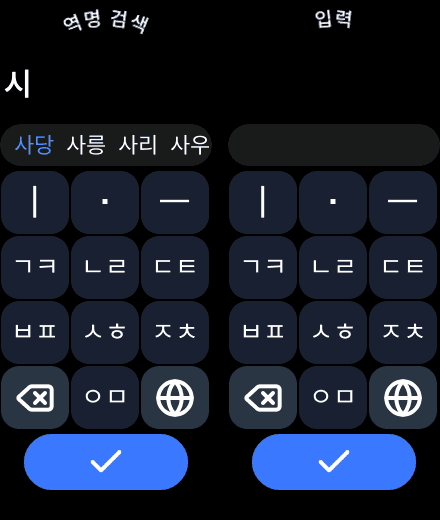

# vela-ime

A Cheonjiin (천지인) keyboard page for Xiaomi Vela quick apps. Made for the Mi Band 10 (212×520); a page you open, type in, and get the text back from.



Three layouts (한글, English multi-tap, 123) on the globe key, whole-character backspace, a suggestion strip fed by your own function, and a short haptic tick per key. The composition engine (`cheonjiin.js`) is plain JS, tested against [hwalja](https://github.com/anaclumos/hwalja)'s tables.

## Use
1. Copy `src/` into your app's `src/`.
2. In `manifest.json` add the page and features:
```json
"features": [ { "name": "system.router" }, { "name": "system.storage" }, { "name": "system.vibrator" } ],
"router": { "pages": { "pages/ime": { "component": "ime" } } }
```
3. Open it, and read the text when your page is shown again:
```js
import { openIme, takeImeResult } from '../../utils/ime.js'

open() { openIme({ title: '검색어', text: '' }) },
async onShow() {
  const text = await takeImeResult()   // '' if the user left without confirming
  if (text) this.search(text)
}
```

## Suggestions
Edit `src/utils/suggest.js` (default: none). `suggest(q, limit)` gets what was typed since the last space as key atoms; return up to `limit` words (the page asks for at most 3, once a key has been pressed) whose `atoms(word)` start with `q` (`atoms` is in `cheonjiin.js`). It may be async.

## Notes
- An image is cropped, not scaled, to its box: show icons at their file size.
- The emulator's bold font has no Hangul (the watch's does), so bold Korean shows as boxes there.
- Remove the vibrate call in `ime.ux` and `system.vibrator` if you don't want haptics.

## Test / icons
`git clone https://github.com/anaclumos/hwalja ../hwalja-ref && npm test`. Icons are Lucide (`npm run icons`, needs `lucide-static` and `sharp`).

## Licence
Engine rules derived from hwalja (MIT) and icons from Lucide (ISC), see `NOTICE.md`. No licence is chosen for this package yet.
